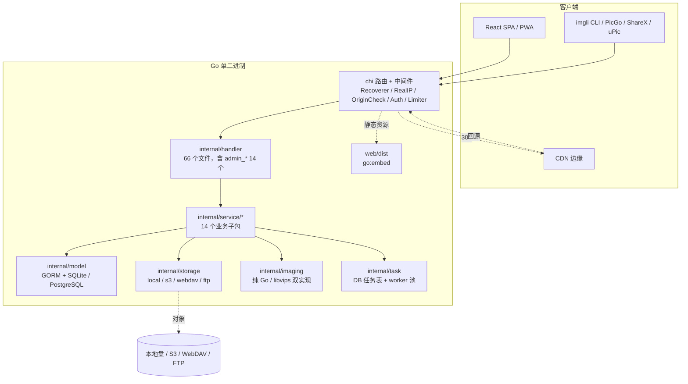

# 系统架构

[← 返回 Wiki 首页](Home.md)

## 分层视图



入口是 [`cmd/imgli/main.go`](../cmd/imgli/main.go)（`serve` → `config.Load` →
`model.Open` → `Migrate` → `Seed` → `server.New(...).Run(ctx)`）。
[`internal/server/server.go`](../internal/server/server.go) 是唯一的装配点：路由、
中间件、依赖注入、后台 goroutine 都在这里注册。

## 仓库目录

| 路径 | 职责 |
|---|---|
| `cmd/imgli/` | CLI 入口与子命令实现（`main.go`、`upload.go`、`import_dir.go` 等） |
| `internal/config/` | 运维配置：默认值 → YAML → `IMGLI_*` 环境变量 |
| `internal/server/` | 路由装配（`server.go`）、SPA 静态服务与 OG 元数据注入（`web.go`） |
| `internal/handler/` | HTTP 层：按域拆分的处理器、中间件、响应信封、SSRF / 限速 / 缩略图宽度 |
| `internal/model/` | 全部 GORM 模型、`AutoMigrate`、外键/索引、`SchemaVersion` 数据迁移、Seed |
| `internal/service/` | 业务逻辑：auth、upload、imagesvc、albumsvc、storagesvc、adminsvc、moderation、stats、webhook 等 |
| `internal/storage/` | `Driver` 接口 `Put/Open/Delete/Exists`、可选 `Presigner`、驱动能力分级 |
| `internal/imaging/` | 缩略图、单次解码处理管线、水印字体、HEIF/vips 构建标签实现 |
| `internal/task/` | 数据库任务表 + 进程内 worker 池 |
| `internal/{token,mail,doctor,version,servecache,linkbuilder,apperr,cliupload}/` | 横切能力：不透明令牌、SMTP、自检、版本升级、源站缓存、外链拼接等 |
| [`web/`](../web/) | React 19 + Vite SPA；`embed.go` 用 `//go:embed all:dist` 暴露 `DistFS()` |
| [`deploy/`](../deploy/) | 配置样例、Compose/Caddy/Traefik/systemd 片段、OCR 旁路、运维脚本 |
| [`scripts/`](../scripts/) | 安装、冒烟、压测、厂商兼容矩阵、字体子集、发版门禁 |
| [`docs/`](../docs/) | 工程 SSOT：兼容矩阵、设计稿、运维清单 |
| [`wiki/`](Home.md) | 本 Wiki |

## 主要依赖（[go.mod](../go.mod)）

| 库 | 用途 |
|---|---|
| `go-chi/chi/v5` | 路由与中间件链 |
| `gorm.io/gorm` + `driver/postgres` | ORM、`AutoMigrate`、PostgreSQL 驱动 |
| `glebarez/sqlite`（间接 `modernc.org/sqlite`） | 纯 Go SQLite，无 CGO |
| `coreos/go-oidc/v3` + `oauth2` | 可选 OIDC SSO |
| `jlaffaye/ftp` | FTP/FTPS 兼容层 |
| `x/crypto` | argon2id 密码哈希 |
| `x/image` | CatmullRom 缩放、WebP 解码、字体绘制 |
| `x/sync` | `singleflight` 防止缩略图生成击穿 |
| `yaml.v3` | YAML 配置解析 |

S3 驱动**不使用 AWS SDK**，而是手写 SigV4 签名与预签名
（`internal/storage/s3/sign.go`、`presign.go`）；WebDAV 使用标准库 `net/http`。

## 请求链路

### 上传

```text
POST /api/v1/upload (multipart)
  → OriginCheck（CSRF）→ Auth（解析身份）→ RequireUserOrAnon
  → GroupMiddleware（用户组分/时/日三档限速）
  → handler.Upload → service/upload
       ├─ 校验扩展名/大小/配额/带宽、秒传复用 (File hash + surface)
       ├─ imaging.ProcessPipeline：一次解码 → 等比缩 → 水印 → 编码
       ├─ storagesvc 解析策略驱动 → Put 原图与默认缩略图
       └─ Enqueue Task: moderate_image（异步机审）
  → 信封 {status,message,data.links.{url,markdown,html,bbcode,thumbnail_url}}
```

### 读图

```text
GET /i/{name} 或 /t/{name}?w=400
  → Auth（匿名也过，用于判定私密图属主/管理员）
  → servesvc 门禁：可见性、口令、过期、次数上限、Referer 防盗链、带宽硬顶
  → 可 302 到 CDN；private 对象用 60s 预签名直连
  → 缺缩略图时从原图补生成（singleflight 合并并发）
  → stats 访问统计（仅源站门禁可见，CDN 边缘命中不可见）
```

SPA 页面路由（`/`、`/s/{key}`、`/a/{id}`）由 `internal/server/web.go` 提供：
`/assets/*` 长缓存 immutable、`index.html` no-cache、`/s/` 与 `/a/` 注入
Open Graph / Twitter 元数据供爬虫读取；非 `/api`、`/i`、`/t`、`/assets` 的
GET/HEAD 路径回落 SPA。

## 数据模型

- 表：`User`、`UserGroup`、`File`、`Image`、`Album`、`AlbumAccessStat`、`APIToken`、
  `Session`、`AuthToken`、`InviteCode`、`StoragePolicy`、`Setting`、`Task`、
  `AuditLog`、`SchemaVersion`、`StorageMigrateJob`、`AccessStat`、`RefererStat`、
  `RefererImageStat`（清单见 `internal/model/model.go` 的 `AllModels()`）。
- `File` 内容寻址，`(hash, surface)` 唯一，支撑同用户秒传；`Image` 软删即回收站，
  携带可见性、过期时间、查看次数上限、访问口令、审核状态等字段。
- 业务配置存 `Setting` KV 表（约 30 个键由 Seed 播种），**不进 YAML**。
- SQLite 使用 WAL、`busy_timeout(5000)`、`foreign_keys(1)`、`mmap_size(0)` 等 pragmas；
  WAL 不可用时回退 DELETE 日志模式。
- 迁移：`AutoMigrate(AllModels()...)` + 显式外键 + `ensureIndexes` +
  `SchemaVersion` v1–v9 幂等数据迁移（surface 回填、私密相册图改 private、
  默认组带宽与 HEIC 后缀补全等）。`serve` 启动自动执行，`imgli migrate` 可手动执行。

## 后台任务与生命周期

| 机制 | 行为 |
|---|---|
| `task.Runner` | 数据库 `tasks` 表 + 进程内 worker 池（worker 数 = CPU 核数）；PostgreSQL 用 `FOR UPDATE SKIP LOCKED`，SQLite 用普通事务认领；最多 3 次重试、15min stuck 重新入队、启动时 requeue 全部 running；30s 轮询并每 10min 清理过期 Session/AuthToken |
| 已注册任务 | `delete_file`（物理删除）、`moderate_image`（机审） |
| 统计 | `stats.Service` 每 60s 刷盘访问 / Referer 聚合 |
| 清理 | 每小时执行回收站、过期图、用户组保留与强制存活策略 |
| 存储搬迁 | `StorageMigrateJob` 落库可续跑，重启从 `cursor_after_id` 恢复 |
| Webhook | 出站事件 HMAC 签名，异步 goroutine 投递 |
| 停机 | 优雅停机 30s，停机前终刷统计 |

## 可观测性

结构化日志统一使用 `log/slog`；GORM logger 为 Warn + 200ms 慢查询。
对外健康检查是 `GET /healthz`（Docker 有 `HEALTHCHECK`），深度自检是
`imgli doctor` 与 `GET /api/v1/admin/system/health`；管理后台另有
`GET /admin/stats`、`/admin/referers/images`、`/admin/logs`（`AuditLog`）。
**没有 Prometheus / OpenTelemetry / metrics 端点。**

相关：[Frontend.md](Frontend.md) · [Storage-and-Media.md](Storage-and-Media.md) ·
[Authentication-and-Security.md](Authentication-and-Security.md) ·
[Development-and-Testing.md](Development-and-Testing.md)
